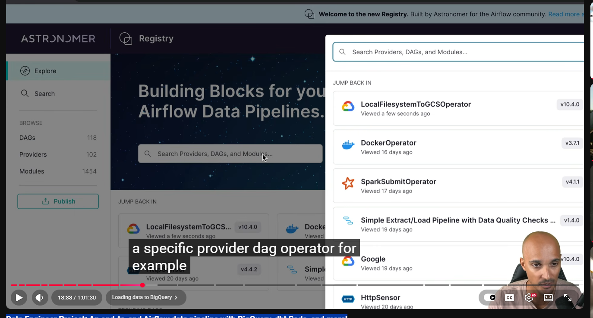

# Data Engineer Project: An end-to-end Airflow data pipeline with BigQuery, dbt Soda, and more!

# source 
source is our csv file form the kaggle 

# ingestion 
we are going ingest in the  big query 

>create a new project 
>go to creation of bucket 

>got IAM and admin 
 >service accounts
 >create a roles 
     > goggle cloud storage -- storage admin 
     > bigquery --- bigqery admin 

so we can use from the airflow 

> add a new key 

> talk to the goggle cloud you need airflow proider 

## airflow 
>go to he admin 
>go to the connection 

## now we want to ingest the data form local to gcp 

we need operator 

## What is an Operator?
An Operator is a reusable task template that tells Airflow what kind of work a task should perform.

## site astronomer registery.astronomer.io
there is operator we can use to ingest data one platform one place to another 

## retail .py 
rom airflow.decorators import dag, task
from datetime import datetime

from airflow.providers.google.cloud.transfers.local_to_gcs import LocalFilesystemToGCSOperator

@dag(
    start_date=datetime(2023, 1, 1),
    schedule=None,
    catchup=False,
    tags=['retail'],
)
def retail():

    upload_csv_to_gcs = LocalFilesystemToGCSOperator(
        task_id='upload_csv_to_gcs',
        src='include/dataset/online_retail.csv',
        dst='raw/online_retail.csv',
        bucket='marclamberti_online_retail',
        gcp_conn_id='gcp',
        mime_type='text/csv',
    )

retail()

## -------------- wroking ------------------

Import DAG — Used to define an Airflow workflow.
Import datetime — Used to specify the start date.
Import operator — LocalFilesystemToGCSOperator is reusable code for uploading local files to Google Cloud Storage.
Define DAG — @dag() creates the workflow configuration.
Start date — datetime(2023, 1, 1) defines the start date.
Schedule — schedule=None means the DAG won't run automatically on a recurring schedule.
Catchup — False prevents Airflow from creating missed scheduled runs.
Tags — ['retail'] categorizes the DAG in the Airflow UI.
Define function — def retail(): defines the workflow.
Create task — LocalFilesystemToGCSOperator() defines the file-upload task.
Task ID — upload_csv_to_gcs identifies the task in Airflow.
Source (src) — Specifies the local CSV file to upload.
Destination (dst) — Specifies the file path inside the cloud bucket.
Bucket — marclamberti_online_retail is the destination GCS bucket.
Connection — gcp_conn_id='gcp' tells Airflow which Google Cloud connection to use.
MIME type — text/csv identifies the uploaded file as CSV content.
Call the DAG — retail() instantiates the DAG so Airflow can discover it.

# load this csv file in bigquery table 
 we have to create the schema in it 

## retail.py 
 from airflow.providers.google.cloud.operators.bigquery import BigQueryCreateEmptyDatasetOperator

create_retail_dataset = BigQueryCreateEmptyDatasetOperator(
        task_id='create_retail_dataset',
        dataset_id='retail',
        gcp_conn_id='gcp',
    )

# astro cli 

**Create an Airflow project —** Generate a standard project structure using astro dev init.
**Run Airflow locally —** Start Airflow services using astro dev start.
**Build Docker images —** Build the project image with your DAGs and Python dependencies.
**Develop and test DAGs —** Test pipeline workflows during development.
**Run individual DAGs —**Execute DAGs in a local worker container using supported Astro CLI commands.
**Manage dependencies —** Configure Python packages in requirements.txt and build them into the project image.
**Validate code —** Use available Astro CLI checks and testing workflows to catch issues before deployment.
**Deploy to Astronomer —** Deploy Airflow projects to Astronomer's hosted platform using astro deploy.
**Support CI/CD workflows —** Integrate project testing and deployment commands into automated pipelines.
**Standardize team development —** Help developers follow a consistent Airflow project structure and local workflow.

astro dev bash :- give control of airflow 

